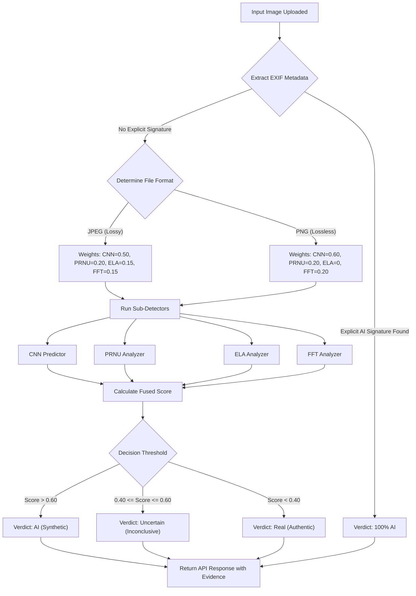

# PhotoGuard AI - Architecture and Evidence Guide

## 1. Project Overview & Current State

**PhotoGuard AI** is a multi-modal forensic detection system built to distinguish authentic, camera-captured images from AI-generated or digitally manipulated images.

### What is currently built:

- **The Multi-Modal Core Pipeline**: Fully implemented. The system runs images through five distinct forensic sub-detectors:
  - **CNN (Spatial & Frequency)**: Analyzes pixel-level patterns using an EfficientNet backbone.
  - **PRNU (Camera Sensor Noise)**: Checks for the unique "fingerprint" left by physical camera sensors (which AI images lack).
  - **ELA (Error Level Analysis)**: Detects double JPEG compression, highlighting spliced or edited regions.
  - **FFT (Fast Fourier Transform)**: Detects high-frequency periodic grid-artifacts left by GANs and Diffusion models.
  - **Metadata Verifier**: Checks EXIF data for known AI software signatures or missing camera hardware tags.
- **The API Backend**: A FastAPI server that orchestrates these sub-detectors, processes the image, and serves visual evidence (heatmaps).
- **The Flutter Frontend**: In active development, allowing users to upload an image and view the forensic breakdown via UI screens.

---

## 2. Preprocessing & How Detectors Find Their Scores

Before the Fusion Engine can combine any numbers, the image must be prepared and analyzed by our four distinct detectors.

#### Step 1: Prepping the Image (Easy-to-Understand Breakdown)

Before the AI can inspect an image, it needs to be "cleaned up" and formatted. If we just threw raw images at the AI, differences in size or lighting would confuse it. Here is how we prep the image:

**1. Standardizing the Colors**

- **What we do:** People upload images in all sorts of formats (like print colors or transparent backgrounds).
- **Why it matters:** The AI only speaks one language: standard **Red-Green-Blue (RGB)**. So, our very first step is to strip away any weird formatting and convert the image into a perfectly standard color picture.

**2. Trimming to Size**

- **What we do:** Our AI model is built to look at images through a very specific "window" that is exactly **224 by 224 pixels** wide.
- **Why it matters:** If an uploaded image is a tall rectangle, we can't just squish it into a square—squishing stretches the pixels and would make the AI think the image is fake! Instead, we carefully zoom in and crop the image so it fits the window perfectly without stretching anything.

**3. Removing Lighting Distractions**

- **What we do:** A picture taken at midnight looks totally different to a computer than a picture taken at noon, purely because of the brightness.
- **Why it matters:** We don't want the AI to flag an image as "Fake" just because it's dark. We use a math trick to "level out" the brightness across all images. This forces the AI to ignore the lighting and focus _only_ on the actual structures and textures in the photo.
- **The "Math Trick" (Z-Score Normalization):** We take the brightness number of every single pixel and subtract the _average_ brightness of millions of normal photos, then divide it by the "standard deviation" (how much brightness usually varies). In short: `New Pixel = (Old Pixel - Average) / Variation`. This mathematically shifts and squeezes the image's lighting onto a perfectly standard scale.

**4. Creating Special Copies for the Detectors**
While the main AI needs the normal color picture, our other forensic tools need something different:

- **Black-and-White Copy:** For our noise and frequency detectors, colors are distracting. We create a simple black-and-white copy for them so they can focus entirely on patterns instead of colors.
- **The "Invisible Noise" Filter:** For our most advanced tests, we apply a special filter that actually _erases_ the visible parts of the picture (like the faces, cars, or trees). What is left behind is just the invisible, microscopic layer of "digital static." This static is exactly where AI generators leave behind their hidden fingerprints!

### Step 2: How the Scores are Calculated

Once preprocessed, the image is passed to the detectors. Here is exactly how they generate their 0.0 (Real) to 1.0 (AI) anomaly scores:

- **CNN Score (e.g., 0.90):** The preprocessed image is passed through our trained AI model (EfficientNet). The model looks for microscopic pixel irregularities—like weird blending, unnatural textures, or structurally impossible shapes (like 6 fingers)—that match the fake images it was trained on. It outputs a raw probability (e.g., 90% sure it's AI = 0.90 score).
- **PRNU Score (e.g., 0.85):** Every real camera leaves behind a unique, microscopic noise pattern (a "fingerprint") on its photos due to manufacturing imperfections in the physical sensor. The PRNU detector uses a denoising filter to extract the image's noise and looks for this fingerprint. If the noise is completely random or missing (which happens when an AI generates an image from scratch on a computer), the anomaly score spikes high (e.g., 0.85).
- **ELA Score (e.g., 0.40):** The ELA (Error Level Analysis) system intentionally resaves the image at a 90% JPEG quality and mathematically compares it to the original. If a specific area of the image changes much more than the rest, it means that area was spliced or edited in later. The severity of this difference is measured as an anomaly score.
  - _Example:_ Imagine a photo of an empty beach. You use Photoshop to paste a UFO into the sky and save it. The beach has now been compressed _twice_ (by the camera, then by Photoshop), but the UFO was only compressed _once_. When our system resaves the image, the beach barely changes, but the UFO degrades heavily. The system spots this mismatch and flags the UFO as fake.
- **FFT Score (e.g., 0.70):** The system converts the image into a 2D mathematical frequency map using a Fast Fourier Transform. AI generators (like GANs and Diffusion models) often leave behind invisible, repeating grid patterns when they upscale images. The FFT analyzer scans for these unnatural mathematical peaks. If it finds strong repeating grids, the score goes up.
  - _Detailed Example:_ To generate high-resolution images, AI models (like Midjourney or Stable Diffusion) don't draw the whole picture at once. They start with a tiny image and "upscale" it mathematically by calculating blocks of pixels (e.g., expanding 8x8 chunks into larger chunks). Because of the way this math works (called upconvolution), the AI leaves behind faint, microscopic seams between these blocks across the entire image.
  - To the human eye, an AI-generated face looks perfectly smooth. But when our system applies a **Fast Fourier Transform (FFT)**, it translates the image from "pixels" into "wave frequencies." If a real camera took the photo, this frequency map looks like a smooth, random blur of energy (because nature is random). But because the AI left behind a perfectly repeating grid of seams, the FFT frequency map will suddenly light up with bright geometric "stars" or a perfect checkerboard of glowing dots (representing that exact repeating block frequency). Since nature never creates perfect mathematical grids, our system spots those glowing dots, knows it's an AI upscaling artifact, and spikes the score to flag it as fake.

---

## 3. The Fusion Engine: System Flow & Mathematics

The `PhotoGuardFusionEngine` (`modules/fusion.py`) acts as the brain of the system. Below is the complete decision-making flowchart and the mathematical formulas used to derive the final verdict.

### 3.1 Decision Flowchart

### 3.2 Plain-English Math Formulas

Each detector returns a score between 0.0 (Real) and 1.0 (AI). The engine calculates a **Final Fused Score** by multiplying each detector's score by its assigned weight and adding them all together.

**Formula for Standard JPEGs:**
Final Fused Score = (CNN Score × 0.50) + (PRNU Score × 0.20) + (ELA Score × 0.15) + (FFT Score × 0.15)

**Formula for PNGs (No Compression Data):**
If the image is a PNG, the ELA compression check won't work. The system adapts by dropping ELA to 0% and increasing the others:
Final Fused Score = (CNN Score × 0.60) + (PRNU Score × 0.20) + (FFT Score × 0.20)

**3-State Decision Classification & Confidence:**

- **AI (Synthetic / Tampered):** If the **Final Fused Score > 0.60**, the prediction is **AI**. Confidence is `Final Fused Score × 100%`.
- **Uncertain (Inconclusive / Mixed Evidence):** If the **Final Fused Score is between 0.40 and 0.60**, the system issues an **Uncertain** verdict with amber warning badges and detailed forensic reason explaining borderline or conflicting detector evidence. Confidence reflects closeness: `max(Score, 1 - Score) × 100%`.
- **Real (Verified Authentic):** If the **Final Fused Score < 0.40**, the prediction is **Real**. Confidence is `(1.0 - Final Fused Score) × 100%`.

### 3.3 Simple Calculation Examples

#### Example 1: An AI-Generated JPEG (Deepfake)

A user uploads a deepfake JPEG. The detectors return the following scores (1.0 is max suspicion):

- **CNN Score:** 0.90 (Highly suspicious)
- **PRNU Score:** 0.85 (Missing camera noise)
- **ELA Score:** 0.40 (Minor compression errors)
- **FFT Score:** 0.70 (AI frequency patterns detected)

**Calculation:**
Final Fused Score = (0.90 × 0.50) + (0.85 × 0.20) + (0.40 × 0.15) + (0.70 × 0.15)
Final Fused Score = 0.45 + 0.17 + 0.06 + 0.105
Final Fused Score = **0.785**

Since 0.785 is greater than 0.50, the system flags the image as **AI**.
**Confidence:** 0.785 × 100 = **78.5% AI**

#### Example 2: An Authentic Camera PNG Image

A user uploads an unedited, high-quality PNG taken by a DSLR camera.

- **CNN Score:** 0.10 (Looks very real)
- **PRNU Score:** 0.15 (Valid physical camera noise found)
- **ELA Score:** Ignored (Because it's a PNG)
- **FFT Score:** 0.05 (No AI patterns found)

**Calculation:**
Final Fused Score = (0.10 × 0.60) + (0.15 × 0.20) + (0.05 × 0.20)
Final Fused Score = 0.06 + 0.03 + 0.01
Final Fused Score = **0.10**

Since 0.10 is lower than 0.50, the system flags the image as **Real**.
**Confidence:** (1.0 - 0.10) × 100 = **90.0% Real**

---

## 4. Understanding the Evidence (User Guide)

When the PhotoGuard app returns a verdict, it provides visual and statistical "Evidence" so the user isn't forced to blindly trust a percentage. Here is how users can interpret the submitted evidence in the app:

### A. Grad-CAM Heatmap (The CNN Evidence)

- **What it is:** A colorful visual overlay placed on top of the original image, displaying colors ranging from blue (cold) to red (hot).
- **How to read it:** The "red" and "yellow" heat zones highlight exactly which parts of the image caused the CNN to make its decision. For example, if an AI generator messed up the generation of a hand or an eye, the Grad-CAM heatmap will usually glow bright red right over that specific error, proving to the user exactly _where_ the AI failed.

### B. ELA Visual (Error Level Analysis Evidence)

- **What it is:** A stark, often black-and-white or high-contrast image showing compression levels.
- **How to read it:** In an authentic, unedited photograph, the compression noise should look relatively uniform across the entire image. If someone spliced a fake object into the photo (like pasting a fake person into a real background), that specific object will stand out significantly brighter or darker than the rest of the image in the ELA view, exposing the manipulation.

### C. The Breakdown Scores

The app shows the individual anomaly scores (CNN, PRNU, ELA, FFT).

- **How to read it:** This helps users see _why_ an image was flagged. For example, if an image was taken by a real camera but heavily edited in Photoshop, the CNN score might actually be low (because the scene looks photorealistic), but the **ELA** and **PRNU** anomaly scores will spike high. This statistical breakdown warns the user that while it isn't completely AI-generated, it _has_ been manipulated.

### D. Metadata Tags

- **What it is:** The hidden text data inside the image file (Camera Make, Camera Model, Software).
- **How to read it:** If the Software tag says "Adobe Photoshop", the user immediately knows the image was tampered with. Alternatively, if the Camera Make/Model is completely blank on a high-resolution photo, it is highly suspicious, as real smartphones and DSLRs automatically embed their hardware data.

### E. FFT 2D Frequency Spectrum Visual (Spectral Evidence)

- **What it is:** A 2D log-magnitude Fourier Transform spectrum colormapped in `inferno` (purple to orange to bright yellow).
- **How to read it:**
  - **Natural Photographs:** Display a bright, dense center (low-frequency macro structures) that decays smoothly and symmetrically towards the dark outer borders (natural randomness of light and lens optics).
  - **Generative AI / Upscaled Images:** Exhibit distinct, isolated, bright geometric star spikes, periodic crosses, or grid constellations in the mid-to-high frequency perimeter. These correspond directly to the latent mathematical grid artifacts left behind by transposed convolutions and deconvolutional upsampling in GAN and Diffusion architectures.

